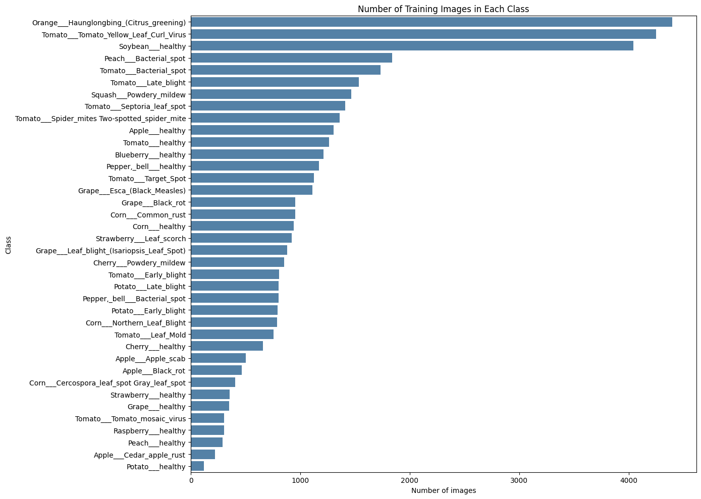
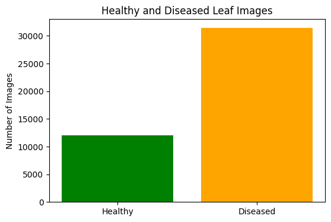

# Crop Disease Detection

This project uses a Convolutional Neural Network (CNN) to identify crop diseases from leaf images. I trained the model using the PlantVillage dataset, then built a Flask web application for predictions, data uploads, retraining, and monitoring.

**Live app:** https://crop-disease-detection-b6xr.onrender.com  
**GitHub:** https://github.com/UShamila/crop-disease-detection  
**YouTube demo:** 

## 1. Dataset and model

I used PlantVillage leaf images covering **38 classes** of healthy and diseased crops.

In the [training notebook](notebook/crop_disease_detection_plantvillage.ipynb), the images are prepared for CNN training. The saved model uses **128 × 128 RGB images** with pixel values divided by 255. The trained model is saved as [`models/crop_disease_model.h5`](models/crop_disease_model.h5).

### Model evaluation

The saved evaluation report contains results from **5,430 test images**:

| Metric | Result |
|---|---:|
| Accuracy | 94.55% |
| Macro precision | 93.63% |
| Macro recall | 92.30% |
| Macro F1-score | 92.68% |

The notebook contains the training and testing work. The full evaluation figures are also saved in [`models/original_evaluation.json`](models/original_evaluation.json).

## 2. Dataset visualizations

### Disease classes



The classes do not have equal numbers of images. Classes with fewer images may be harder for the model to learn.

### Healthy and diseased leaves



There are **12,009 healthy** and **31,433 diseased** images in the training data. This shows that diseased images are more common in this dataset.

### Image brightness


The average brightness of 500 sampled images was **115.06/255**. Lighting varies between images and can affect predictions.

## 3. Web application

The [live dashboard](https://crop-disease-detection-b6xr.onrender.com) has four sections:

- **Prediction:** Upload one JPG or PNG leaf image to see the predicted class and confidence.
- **Insights:** View the three dataset charts above.
- **Retraining:** Upload up to 20 labelled images at a time and use the retraining button.
- **Monitoring:** View application uptime, successful and failed predictions, and average response time.

The Flask API also provides `/predict`, `/health`, `/classes`, `/upload`, `/retrain`, `/retrain/status`, and `/monitoring`.

### Uploading and retraining

Uploaded images are saved in `data/uploads/`, and their filenames and labels are recorded in a SQLite database (`data/uploads.db`). The images are resized and normalized before retraining.

The retraining button starts a new training run using my saved CNN as the starting model. The new candidate is checked against the original model before approval. In the recorded comparison, the original model scored **94.55%** and the candidate scored **94.33%** on the evaluation set, so the original model was kept. See [`models/corrected_candidate_comparison.json`](models/corrected_candidate_comparison.json).

Uploading and retraining require an administrator key. The model needs enough correctly labelled images to retrain, and the original model is not automatically replaced.

## 4. How to run the project

Use **Python 3.11** and run these commands from the project folder:

```powershell
 git clone https://github.com/UShamila/crop-disease-detection.git
 cd crop-disease-detection
 python -m venv .venv
 .\.venv\Scripts\Activate.ps1
 pip install -r requirements.txt
 $env:ADMIN_API_KEY = "replace-with-your-own-long-secret-key"
 python -m app.main
```

Open **http://localhost:5000** in your browser. Use the same administrator key when uploading training images or starting retraining. The key must contain at least 24 characters.

### Docker

With Docker Desktop running, set an administrator key and start the app:

```powershell
$env:ADMIN_API_KEY = "replace-with-your-own-long-secret-key"
docker compose up -d --build
```

Open **http://localhost:5000**. The cloud deployment uses [`Dockerfile.render`](Dockerfile.render) and runs on Render.

## 5. Load testing with Locust

I used Locust to send leaf-image prediction requests through Nginx and compared **one model container** with **two model containers**. Both tests used **5 users**, a **1-user/second spawn rate**, and a **30-second duration**.

| Metric | 1 container | 2 containers |
|---|---:|---:|
| Requests reported by Locust at shutdown | 68 | 67 |
| Failed requests | 0 | 0 |
| Average response time | 443 ms | 592 ms |
| Median response time | 150 ms | 130 ms |
| 95th-percentile response time | 3,200 ms | 5,300 ms |
| Throughput | 2.46 req/s | 2.37 req/s |

Both tests completed without reported failures. The two-container test had a slightly faster median response time, but a slower average response time and lower throughput. Adding a container did not improve overall performance in this short test.

I also checked the monitoring endpoint in each container: **container 1 processed 33 predictions** and **container 2 processed 34**, confirming that both received traffic.

**Test evidence:** [Locust results](tests/results/locust/) · [Container verification](tests/results/locust/container_verification.md) · [Other load tests](tests/results/load_test_summary.md)

To repeat the Locust tests, prepare a local test image at the path used in [`tests/locustfile.py`](tests/locustfile.py), install Locust, and run:

```powershell
pip install locust
docker compose -f docker-compose.loadtest.yml up -d --build
python -m locust -f tests/locustfile.py --headless --host http://localhost:8080 --users 5 --spawn-rate 1 --run-time 30s

docker compose -p crop-loadtest-two -f docker-compose.loadtest-two.yml up -d --build
python -m locust -f tests/locustfile.py --headless --host http://localhost:8081 --users 5 --spawn-rate 1 --run-time 30s
```

## 6. Project files

- [`notebook/`](notebook/) — data preprocessing, CNN training, and evaluation notebook.
- [`app/`](app/) — Flask API, prediction, upload, retraining, monitoring, and dashboard.
- [`models/`](models/) — trained CNN, class names, and evaluation results.
- [`tests/`](tests/) — Python load tests, Locust tests, and saved results.
- [`Dockerfile.render`](Dockerfile.render) and [`docker-compose.yml`](docker-compose.yml) — deployment and Docker setup.

The full dataset and uploaded images are not included in GitHub. The saved model and code are included.

## 7. Video demonstration

**YouTube link:** https://youtu.be/4xPuJkHdwvI
